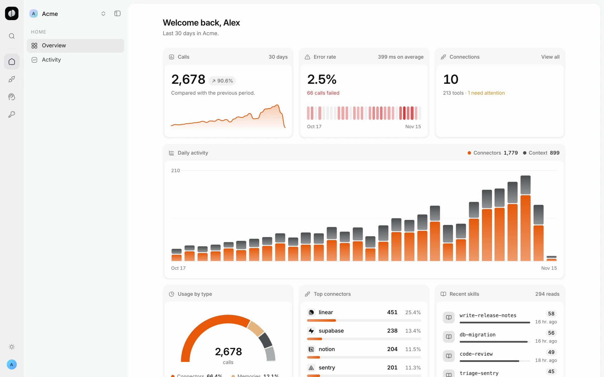
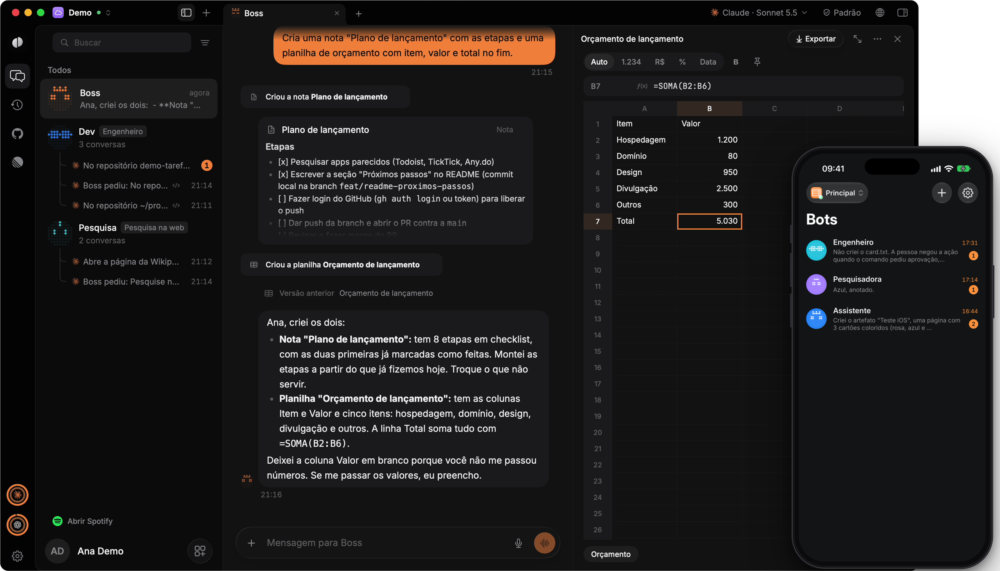

<p align="center">
  
</p>

<h1 align="center">runelay</h1>

<p align="center">
  Open-source, self-hosted tools for people who work with AI agents.
</p>

<p align="center">
  <a href="https://runelay.com">Website</a> ·
  <a href="https://docs.runelay.com">Docs</a> ·
  <a href="https://github.com/runelay/runelay">GitHub</a> ·
  <a href="https://x.com/userunelay">X</a>
</p>

## [runelay](https://github.com/runelay/runelay)

A self-hosted MCP gateway: one endpoint for every account, skill and memory your agents use.

<p align="center">
  <picture>
    <source media="(prefers-color-scheme: dark)" srcset="./assets/runelay-dark.webp" />
    
  </picture>
</p>

Connect Linear, GitHub, Notion, Supabase and the rest once, on your own server. Claude Code, Codex, Cursor, Antigravity and Grok all see the same tools and the same context. runelay runs no model: your agent thinks, runelay is where it finds tools and context.

- **Connect once**: curated MCP servers with one-click OAuth, plus any remote MCP, local MCP or OpenAPI spec.
- **Shared memory**: linked, versioned notes. What one agent learns, all of them know.
- **Skills that travel**: your `SKILL.md` folders, searchable and served on demand.
- **Migrate in one command**: `runelay migrate` brings MCP servers, memories, skills and instructions from Claude Code, Codex, Cursor, Grok, Gemini and OpenCode.
- **One key per agent**, every call audited, revoke one without touching the others.
- **Yours**: one Docker container or the desktop app for Mac, Windows and Linux. SQLite, web dashboard, MIT.

```sh
curl -fsSL runelay.com/install | sh
```

## r/bots

<p align="center">
  
</p>

A team of bots that is yours. Each bot has its own instructions, model, tools and conversations, runs on your server with the Claude subscription you already pay for, and you talk to them from a native Mac app.

- A Bun server in Docker running each turn on the Claude Agent SDK, or on Codex, Cursor and Grok.
- Code mode: a git worktree per conversation, live diff, commit, push and PR with CI status.
- A browser per bot, a virtual desktop on the server and your own Mac, always with your approval.
- Routines, voice calls, GitHub and Linear, and every runelay connector, memory and skill.

r/bots is in private development.
